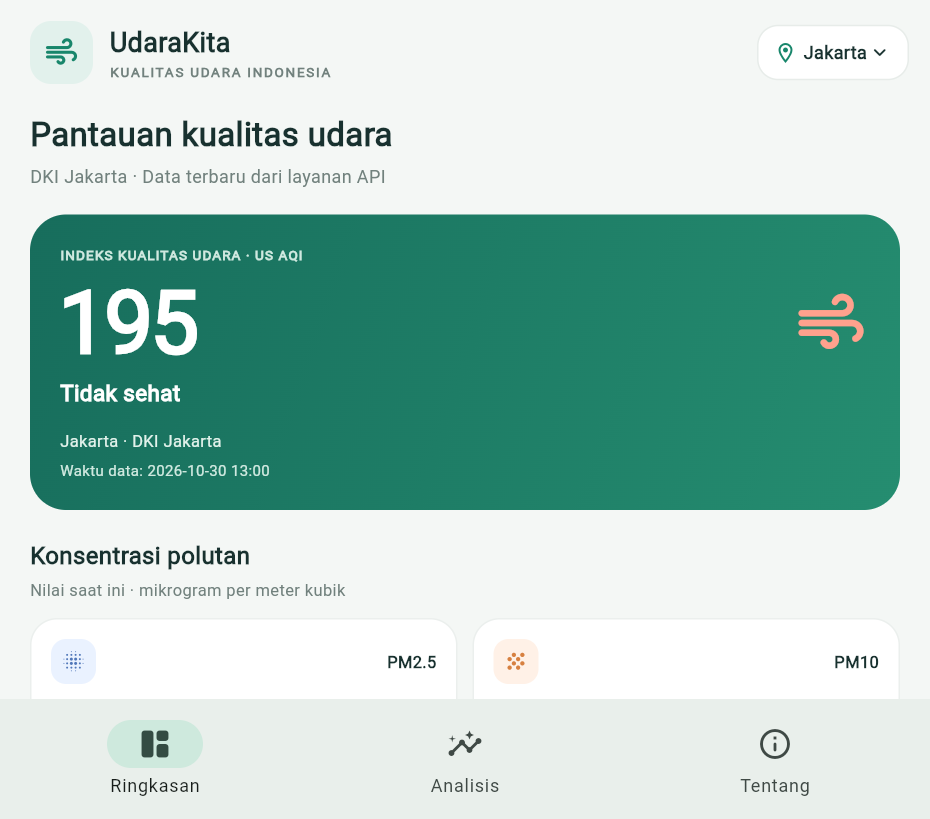

# UdaraKita Indonesia

Aplikasi Flutter studi kasus kualitas udara di beberapa kota Indonesia. Aplikasi
mengambil data langsung dari Open-Meteo Air Quality API, menampilkan nilai
US AQI, konsentrasi polutan, tren per jam, dan perbandingan kota.

## Tampilan aplikasi



## Fitur

- Pantau 23 kota di enam kelompok wilayah:
  - **Sumatra:** Banda Aceh, Medan, Pekanbaru, Padang, Palembang, Bandar Lampung.
  - **Jawa:** Jakarta, Bandung, Semarang, Yogyakarta, Surabaya.
  - **Bali & Nusa Tenggara:** Denpasar, Mataram, Kupang.
  - **Kalimantan:** Pontianak, Palangka Raya, Banjarmasin, Samarinda.
  - **Sulawesi:** Makassar, Manado, Palu.
  - **Papua:** Jayapura, Sorong.
- Lihat nilai US AQI, PM2.5, PM10, NO₂, dan O₃.
- Filter perbandingan kualitas udara berdasarkan pulau dan ketuk kota untuk
  membuka pantauannya.
- Pilih kota dari menu, tarik layar untuk memuat ulang, dan coba lagi jika API
  tidak dapat diakses.
- Status memuat dan pesan galat yang informatif.

## Menjalankan aplikasi

Pastikan Flutter terpasang dan perangkat terhubung ke internet.

```shell
flutter pub get
flutter run
```

## Struktur kode

```text
lib/
  app.dart
  main.dart
  models/
    air_quality.dart
    city.dart
  pages/
    about_page.dart
    air_quality_home.dart
    analysis_page.dart
  services/
    air_quality_api.dart
  widgets/
    air_quality_widgets.dart
```

## Sumber dan batasan data

Data diperoleh dari [Open-Meteo Air Quality API](https://open-meteo.com/en/docs/air-quality-api).
Lisensi data Open-Meteo adalah [CC BY 4.0](https://creativecommons.org/licenses/by/4.0/).
API menyediakan estimasi kualitas udara berbasis koordinat kota, bukan pembacaan
langsung dari sensor lokal.

Indeks yang ditampilkan adalah **US AQI** dari API, bukan **ISPU resmi Indonesia**.
Aplikasi ini merupakan prototype pembelajaran dan tidak ditujukan untuk keputusan
kesehatan.

## Pengujian

```shell
flutter analyze
flutter test
```
